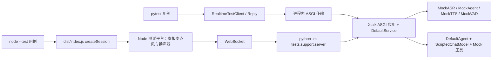

2026-10-27

# 需求变更

- 维护者需要在没有真实模型服务、GPU 和声卡的环境里自动回归对话体验，作为日常修改的门禁。
    - 验证对象是用户和接入方可感知的对话行为：问有所答、说完才答、插话即停、只记住听到的内容、多轮记忆、工具调用时机、后台异步工具的主动播报、出错后对话继续。
    - 验证穿过真实服务管线与 Realtime 协议边界，不依赖手工拼装内部模块或调用私有处理器。
    - 不验证本仓库的具体实现方式，例如 TTS 切句规则、音频分块与投递预算、内部事件顺序、配置回显细节与协议头部字段；这些可以改动而不影响对话体验，改动时不应导致测试失败。
- 前端 SDK 需要以真实后端为对手方验证应用可感知的对话体验，确认前后端对同一协议的理解一致。
- 现有 `tests/` 与 `frontend/tests/` 的组织方式和假设不再沿用，先清空再按新方案重建。
- 第一阶段只验证对话体验；模型适配器单元测试和真实模型验收不属于本阶段。

# spec变更

- 旧测试清理。
    - 删除 `tests/` 与 `frontend/tests/` 下全部内容，包括迁移基线 fixture 与缓存文件；两个目录按下文结构重建。
    - `app/tests/`、`full_duplex_eval_pipeline/`、`scripts/test.py` 及其文档不变；`scripts/test.py` 仍使用旧 `/ws` 协议与已删除的 `mount_routes`，本变更不修复。
    - `kkspec/changes/archive/` 中引用旧测试文件的历史记录不改写。
- 测试分层与运行方式。
    - 后端测试位于 `tests/`，使用 pytest 及 anyio 自带的 pytest 插件运行异步用例与异步 fixture：含异步用例的测试模块声明 `pytestmark = pytest.mark.anyio`，`tests/conftest.py` 的 `anyio_backend` fixture 固定返回 `asyncio`；anyio 由 `test` extras 中 fastapi 的依赖链提供，不新增测试依赖。
    - 沿用 `pyproject.toml` 现有 pytest 配置：`--import-mode=importlib`、`testpaths = ["tests"]` 与 `pythonpath = ["."]`（使 `tests.support` 可被导入）；运行命令为仓库根目录 `python -m pytest`，依赖为 `test` extras。
    - 后端测试在进程内直接驱动 `Xtalk.create_asgi_app()` 返回的 ASGI 应用，不监听端口、不依赖 uvicorn 或 FastAPI。
    - 前端测试位于 `frontend/tests/`，以 TypeScript 编写并由 Node 原生类型剥离执行（需 Node 22.18 或更高），只使用可擦除语法；`npm test` 先执行 `npm run build`，再运行 `node --test "tests/**/*.test.ts"`，测试只通过 `dist/index.js` 的公开 API 访问 SDK。
    - 前端测试以子进程方式启动 Python Mock 服务作为真实后端；缺少 Python 环境或 uvicorn 时测试失败并输出原因，不静默跳过。
    - GitHub Actions `Tests` 工作流的 backend job 保持现有安装与 `pytest -rs`；frontend job 在 `npm ci` 前安装 Python 3.12、CPU 版 torch 与 `-e ".[test]"`，Node 版本保持 22。
    - 两套测试均只观察协议消息与公开状态，不读取服务端私有状态，不订阅内部事件总线。
- 断言准则（所有场景共同遵守）。
    - 断言表达用户或接入方可感知的结果：转写文本、回复文本、是否有语音、语音对应的文本、回复开始与停止的相对时机、记忆内容、错误后能否继续。
    - 不断言音频块数量、单块时长、转写增量条数、片段切分、投递预算、事件之间非协议规定的先后顺序、配置回显的完整字段、二进制头部字段、ID 命名格式。
    - 时序断言只用协议语义锚点表达，例如"回复的开始事件晚于讲话结束事件"、"停止之后不再有该回复的音频"；不使用 `asyncio.sleep` 等待行为发生，否定断言以后续确定事件为锚点。
    - 每个测试使用独立应用与连接。
- 测试语音契约（后端 `tests/support/speech.py` 与前端 `frontend/tests/support/speech.ts` 实现同一契约）。
    - 一段测试语音由一个语句编号 `id`（0 到 63）生成：有声段为单频正弦波，频率 `400 + 60 * id` Hz，幅度为满刻度的 0.5；静音段全零；PCM16 单声道，采样率由调用方指定。
    - 识别：对连续有声样本按过零率估计频率，取最接近的 `id`，偏差超过 20 Hz 时识别为无效；有声判定为帧均方根超过满刻度的 0.05。
    - 该契约在 24 kHz 到 16 kHz 重采样后仍可识别。
    - 语句编号到文本的固定表：0 `你好`、1 `请讲一个很长的故事`、2 `帮我查一下天气`、3 `现在报错`、4 `你刚才说了什么`、5 `慢慢说`、6 `让合成失败`、7 `识别失败`；8 到 63 为 `第{id}句话`。
- Mock 模型契约。
    - 共同约束。
        - 四个 Mock 模型位于 `tests/support/mock_models/`，通过 `@model` 注册为 `MockASR`、`MockAgent`、`MockTTS`、`MockVAD`，导入该包即完成注册；工具场景另用真实 `DefaultAgent` 搭配脚本聊天模型与 Mock 工具（见下文），因为工具执行与异步播报的行为位于 `DefaultAgent` 与 `ToolEngine`，由 MockAgent 模拟只会测试到模拟本身；不进入 `src/xtalk` 包，`src/xtalk/models/*/dummy.py` 不改动。现有 Dummy 模型不满足测试需要：DummyASR 恒定返回同一文本，DummyAgent 不支持历史注入与指令，DummyTTS 输出含 WAV 头且采样率与数据不符，且没有 Dummy VAD。
        - 所有 Mock 直接实现 `async_*` 方法，不经过线程池；`clone()` 返回携带相同配置的新实例，会话间无共享可变状态；行为完全由配置与输入决定，进程内与子进程两种运行方式下一致。
        - 设计目标：Mock 的输出由输入唯一决定，并且 Mock 的内部状态（听到了什么、记住了什么）能通过对话内容本身暴露出来，测试无需读取服务端私有状态；Mock 不迎合服务层的切分、分块或预算实现。
    - MockVAD 替代语音活动检测模型，使服务端自动轮次（判定讲话开始与结束、自动提交）真实运行。
        - 行为：实现 `VAD`，帧均方根除以满刻度大于 `threshold * 0.1` 判定为语音（默认 `threshold` 0.5）；`set_threshold` 更新阈值；`detect_frames` 逐帧判定；`reset` 无状态。
    - MockASR 替代语音识别模型，把测试语音还原为固定文本，使输入音频必须经过服务端重采样、缓冲与 ASR 管线才能得到正确转写。
        - 行为：实现 `ASR`，累积本轮有声音频，按测试语音契约识别语句编号并查表得到文本；部分结果为完整文本的非递减前缀（随累积音频增长），`is_final=True` 返回完整文本；无法识别或无有声音频时返回空串；语句 7 在 `is_final=True` 时抛出 `RuntimeError`。
    - MockAgent 替代 LLM Agent，按固定规则表回复，并能在回复中说出自身记忆，使记忆正确性可在对话内容上断言。
        - 行为：实现 `Agent` 的 `async_accept`、`get_chat_history` 与 `append_context`（服务端在只转写不回复的轮次通过它写入用户文本）；维护角色与文本的历史；收到最终转写（`asr_final`）时按规则表产出回复文本，可分多次产出；收到播放进度与结算（`response_update`、`response_finish`）时按 `response_id` 写入或替换助手历史，使助手历史只包含实际播放的文本；其他上下文类型不产出。
        - 规则表及各项支撑的体验：
            - `你好` → `你好，我是测试助手。`：基本问答。
            - `请讲一个很长的故事` → `故事第一句。` 到 `故事第八句。` 共八句：回复足够长，用于插话与"字幕不超前于语音"。
            - `帮我查一下天气` → 先产出 `我来查一下。`，再产出工具调用 `{"name": "mock_lookup", "args": {"query": "天气"}}`，再产出 `AgentTurnBoundary`，最后产出 `今天晴。`：工具调用的时机与结果播报。
            - `现在报错` → 产出 `马上出错。` 后抛出 `RuntimeError`：生成失败后对话继续。
            - `你刚才说了什么` → `上一句是：{最近一条助手历史文本}。历史共{本轮用户消息之前的历史条数}条。`，无助手历史时文本为 `无`：记忆正确性，包括多轮记忆、插话后只记住听到的部分、只转写不回复的轮次计入记忆。
            - `慢慢说` → 五句 `慢慢说第N句。`，相邻句之间等待配置 `sentence_interval_ms`（默认 200）：生成持续足够久，用于取消。
            - `让合成失败` → `合成失败。`：与 MockTTS 配合产生合成失败。
            - 其他文本 → `收到：{文本}。`：兜底回复，并用于验证文本与语音输入得到同样的回复。
    - MockTTS 替代语音合成模型，产出时长与文本长度成正比、内容可区分的音频，使"有没有语音"与"语音对应哪段文本"可被观察。
        - 行为：实现 `TTS`，`sample_rate` 为 24000；每次调用产出一段 PCM，时长为 `max(min_ms, ms_per_char * 字符数)`（默认 200 与 80）；音频为正弦波，频率由文本内容确定（同一文本总得到同一频率，不同文本频率不同）；文本包含 `合成失败` 时抛出 `RuntimeError`；不实现 `set_voice` 与 `set_emotion`。
    - 脚本聊天模型 `ScriptedChatModel`（`tests/support/mock_models/scripted_chat_model.py`）替代 LLM，与真实 `DefaultAgent` 和 `ToolEngine` 组合，仅用于 `test_tools.py`。
        - 行为：继承 LangChain `BaseChatModel`，无状态，输出只由传入的消息列表决定；`bind_tools` 返回自身（工具模式由消息内容决定）；流式输出逐字符产出。
        - 决策顺序：最后一条消息为工具结果（`ToolMessage`）时按工具结果规则产出；否则按最后一条用户消息的规则表产出。
        - 用户消息规则表：`你好` → `你好，我是测试助手。`；`第{n}句话` → `收到：第{n}句话。`；`帮我查一下天气` → 先产出 `我来查一下。`，再产出工具调用 `mock_lookup(query="天气")`；`定一个计时器` → 产出工具调用 `mock_timer(duration_seconds=1.0)`；`定一个长计时器` → `mock_timer(duration_seconds=3)`；`定一个带提醒的计时器` → `mock_timer(duration_seconds=1.2, reminder_interval_seconds=0.3)`；`停止计时器` → 从历史中最近一条 `mock_timer` 工具结果取得调用 ID，产出 `stop_async_tool(source_call_id=该 ID)`；`计时器进度如何` → 同法产出 `id_to_async_tool_status(source_call_id=该 ID)`；其他 → `收到：{文本}。`
        - 工具结果规则：`mock_lookup` 结果 → `今天晴。`；`mock_timer` 初始结果（running）→ 若该调用带 `reminder_interval_seconds` 则只产出工具调用 `subscribe_async_tool(source_call_id=该 ID)`，否则产出 `计时器已开始。`；`subscribe_async_tool` 结果 → `计时器已开始，会提醒你。`；`stop_async_tool` 结果 → `计时器已停止。`；`id_to_async_tool_status` 结果 → `计时器进度：{结果内容}。`；`async_tool_updated` 结果中 `running=true` → `计时进行中：{tool_output}。`，`running=false` → `计时结束：{tool_output}。`
    - Mock 工具（`tests/support/mock_models/mock_tools.py`）。
        - `MockLookupTool` 为 `SyncTool`，`name="mock_lookup"`，输入 `query: str`，返回内容 `今天晴`。
        - `MockTimerTool` 为 `AsyncTool`，`name="mock_timer"`，输入 `duration_seconds: float` 与可选 `reminder_interval_seconds: float`；`emit_initial` 立即返回 `Running("计时开始，共{duration}秒。Tool call ID: {id}")`（`ToolEngine` 要求初始结果包含调用 ID）；`aemit_updates` 在设置提醒间隔时每隔该间隔产出 `Running("已过{elapsed}秒")`，到时产出 `Finished("计时完成，共{duration}秒")`；`stop` 标记停止后不再产出任何更新；`status` 返回 `已过{elapsed}秒`；`subscribe_by_default=False`。
- 基座自检（`tests/support/test_mock_contracts.py`）。
    - 定位为测试基座自身的确定性检查，不经过服务管线、ASGI 应用或协议；失败时表示基座问题，与产品行为无关。
    - 语音编解码：0 到 63 每个 `id` 生成后识别回原 `id`；经 24 kHz 到 16 kHz 重采样后仍识别回原 `id`；全零静音判定为无声，测试语音有声段判定为有声。
    - MockASR：同一语句分段送入时，部分结果是完整文本的非递减前缀，`is_final=True` 返回完整文本；静音或无法识别返回空串；语句 7 的最终识别抛出 `RuntimeError`；`reset` 后不残留上一轮音频。
    - MockAgent：规则表每一项对 `asr_final` 的产出序列（文本、工具调用字典、`AgentTurnBoundary`、异常）与契约一致；摘要回复在无助手历史、有助手历史及 `response_finish` 替换后给出约定文本与历史条数；非 `asr_final` 上下文不产出；`clone` 后历史为空。
    - MockTTS：时长与文本长度成正比且不低于 `min_ms`，`sample_rate` 为 24000，相同文本频率相同、不同文本频率不同；含 `合成失败` 的文本抛出 `RuntimeError`。
    - MockVAD：均方根恰高于与恰低于 `threshold * 0.1` 的帧分别判定为语音与非语音；`set_threshold` 后判定边界随之变化；`detect_frames` 结果与逐帧判定一致。
    - ScriptedChatModel：对每条用户规则与工具结果规则，给定构造的消息列表时产出约定文本或工具调用；`停止计时器` 与 `计时器进度如何` 取到历史中最近的 `mock_timer` 调用 ID。
    - MockTimerTool：直接驱动 `ToolEngine` 调用时，初始结果为 `Running`，不设提醒时只收到一次 `Finished`，设提醒时先收到若干 `Running` 再收到 `Finished`，调用停止后不再收到更新。
- 后端测试基座契约。
    - `tests/support/server.py` 提供 `mock_config(*, vad=True, api_keys=(), tools=False) -> dict` 与 `build_mock_xtalk(**同参数) -> Xtalk`：配置使用上述四个 Mock 名称；`tools=True` 时 `llm_agent` 改为 `DefaultAgent`，参数为 `ScriptedChatModel` 实例与 `[MockLookupTool, MockTimerTool]`（`proactive=False`，无 backchannel）；`service_config` 含 `realtime_api`、`vad_min_speech_ms=100`、`vad_redemption_ms=200`、`forced_alignment.stop_ack_timeout_ms=300`；`vad=False` 时不配置 VAD 模型。这些参数只用于缩短测试时间，断言不依赖其具体数值。
    - `python -m tests.support.server [--host 127.0.0.1] [--no-vad] [--api-key KEY]` 以预绑定的随机端口启动 uvicorn，lifespan 启动完成后在 stdout 输出一行 JSON `{"port": N, "url": "ws://host:N/v1/realtime?model=xtalk"}`，收到 SIGTERM 或 SIGINT 后完成关闭。
    - `tests/support/asgi.py` 提供 `InProcessServer(app)`：异步上下文管理器驱动 lifespan 启动与关闭；`connect(path="/v1/realtime", *, query, headers, subprotocols) -> AsgiWebSocket` 完成握手，握手被拒绝时返回关闭码；`AsgiWebSocket` 提供 `send_json`、`send_bytes`、`receive() -> dict | bytes | Closed`；`http(method, path, headers) -> (status, headers, body)` 用于 `/v1/models`。
    - `tests/support/client.py` 提供 `RealtimeTestClient`，以"对话参与者"的视角封装协议：
        - 连接：`open(session_update=None)` 等待会话就绪（`session.created`），有更新时发送并等待确认；`close()` 关闭连接；`events` 为全部 S→C 消息日志，二进制音频消息解析为含 `type`、头部字段与 `pcm` 的字典；`wait_for(type, *, where=None, timeout=5.0)` 按游标返回首个匹配事件。
        - 输入：`say(id, *, voiced_ms=600, trailing_silence_ms=700, binary=False, realtime=True)` 以 24 kHz 发送测试语音，默认按实时节奏（每 20 ms 一条消息）发送，使讲话期间发生的服务端事件与真实使用一致，`realtime=False` 时尽快发送；尾部静音长于服务端的讲话结束判定窗口，轮次无需后续输入即可结束；`silence(ms)` 只发送静音；`commit()`、`clear()`、`speech_start()`、`send_text(text, *, generate_response=True, item_id=None)`、`cancel(response_id=None)` 发送对应事件。
        - 观察：`wait_reply(*, after=None, timeout=10.0) -> Reply` 等待下一个 Response 到达终态并返回摘要（包括没有用户输入时系统主动发起的回复）：`response_id`、`status`、`transcript`（生成完成的语音转写或文本）、`audio_ms`（收到的语音总时长）、`heard_text`（播放结算文本，播放结算完成前为 `None`）；`wait_transcript(*, timeout=5.0) -> str` 等待最近一次 `say` 的最终转写文本；`wait_heard(reply, *, timeout=5.0) -> str` 等待该回复的播放结算文本；`wait_until_heard(response_id, ms, *, timeout=5.0)` 等待听到约 `ms` 毫秒（或播放已在该限制处暂停）；`find(type, *, where=None, after=-1, before=None)` 返回日志中某一区间内的事件，用于否定断言；`replies` 为已到达终态的 Reply 列表；`transcript` 在回复被中途停止时为已播报的文本。
        - 播放模拟（表达"用户听到了多少"）：默认 `auto_play=True`，收到的语音立即视为已听完并按协议确认与结束；`hear_up_to(ms)` 使当前正在播放的回复、否则下一个开始的回复在听到约 `ms` 毫秒后暂停（限制只作用于一个回复），之后可 `resume()`；服务端要求停止播放时回报尚未确认的已听时长；`respond_to_stop=False` 时不回报。确认与结束消息的发送细节由基座封装，测试不直接操作。
    - `tests/conftest.py` 提供 `server` fixture（按测试函数构建 Mock 应用并驱动 lifespan，`@pytest.mark.mock_config(**kwargs)` 覆盖配置）与 `connect` fixture（返回已 `open` 的 `RealtimeTestClient`，接受 `session_update`、`config` 覆盖与客户端选项；同一测试内可多次调用以建立多个会话）。
    - `tests/support/__init__.py` 在导入时把仓库 `src` 置于 `sys.path` 最前，使 pytest 与 Mock 服务子进程始终运行本仓库的源码，而非环境中另行安装的 xtalk。
- 后端场景（`tests/e2e/`，每个文件内的用例均在真实 `DefaultService` 管线上运行）。
    - `test_access.py`（接入）：默认无凭证即可连接并得到会话就绪；配置 `api_keys` 后缺失或错误凭证无法建立会话，Bearer 与子协议两种正确凭证均能建立会话；`GET /v1/models` 遵循同样的凭证规则并列出本实例模型；未知 `model` 无法建立会话。
    - `test_text_conversation.py`（文本对话）：发送 `你好` 得到一个 `completed` 的回复，`transcript` 等于 `你好，我是测试助手。` 且 `audio_ms > 0`；用户消息以客户端提供的 `item_id` 回显且不产生语音转写事件；第二轮 `你刚才说了什么` 的回复文本引用第一轮回复并给出历史 2 条；空白文本与超过 8192 字节的文本被拒绝且对话可继续（随后 `你好` 仍得到回复）。
    - `test_voice_conversation.py`（语音对话）：`say(0)` 的最终转写为 `你好` 且回复与文本输入 `你好` 相同；回复的开始晚于系统判定的讲话结束（`response.created` 在 `input_audio_buffer.speech_stopped` 之后），且讲话期间没有回复开始；只发送静音时直到后续 `你好` 的回复到达都没有其他回复；连续两轮语音各自得到正确转写与回复；Base64 与二进制输入得到相同转写与回复；`turn_detection: null` 时持续发送音频不自动回复，`commit` 后得到回复，空缓冲 `commit` 返回错误且对话可继续；`create_response: false` 时语音只转写不回复，但随后 `你刚才说了什么` 的历史条数计入该轮用户输入；同一会话中语音轮次与文本轮次共享记忆。
    - `test_interruption.py`（插话与取消）：`say(1)` 得到长回复，`hear_up_to` 听到一部分后 `say(0)`：旧回复停止（收到停止要求并回报后得到其 `heard_text`），`heard_text` 为长回复全文的非空真前缀，停止之后不再收到旧回复的语音，新回复针对 `你好`；以 `say(4)` 作为插话时，其回复的上一句等于旧回复的 `heard_text` 而非完整文本；`interrupt_response: false` 时，从讲话开始到讲话结束之间不出现旧回复的停止要求与终态（讲话本身不打断，后续新回复的开始由服务端既有行为决定）；`慢慢说` 期间 `cancel()` 使该回复以 `cancelled` 终止且其后无该回复的语音或文本，无活动回复时取消返回错误；`respond_to_stop=False` 时系统仍能结算旧回复并正常回答下一轮。
    - `test_heard_text.py`（字幕与语音同步）：长回复播放过程中，服务端每次给出的已播放文本（`playback.updated.text`）都是 `transcript` 的前缀且单调增长，且在尚未听完全部语音时不等于全文；全部听完后 `heard_text` 等于 `transcript`。
    - `test_tools.py`（工具调用，使用 `tools=True` 配置即真实 `DefaultAgent` + `ScriptedChatModel` + Mock 工具）。
        - 同步工具：`帮我查一下天气` 先得到 `我来查一下。` 的回复，工具调用通知（`response.tool.called`，`name=mock_lookup`）在该回复播放结束之后到达，随后得到 `今天晴。` 的回复。
        - 同步工具被打断：在 `我来查一下。` 播放中 `say(0)`，直到 `你好` 的回复到达都不出现工具调用通知，也没有 `今天晴。` 的回复。
        - 异步工具立即答复：`定一个计时器` 得到 `计时器已开始。` 的 `completed` 回复，且该回复在计时结束前到达（其终态早于后续主动播报的开始）。
        - 异步工具主动播报：上一步之后不再发送任何输入，收到一个系统主动发起的回复，文本以 `计时结束：` 开头、`audio_ms > 0`、`completed`。
        - 订阅进度：`定一个带提醒的计时器` 得到 `计时器已开始，会提醒你。`，随后在没有输入的情况下依次收到至少一个以 `计时进行中：` 开头的回复和一个以 `计时结束：` 开头的回复，且进行中的回复都早于结束回复。
        - 不打断用户：`定一个计时器` 得到开始回复后立即 `say(9, voiced_ms=1200)`（实时发送，计时在讲话期间结束）：讲话期间没有回复开始；讲话结束后第一个回复是对 `第9句话` 的回答，之后才有计时结束的播报。
        - 不截断回答（`xfail(strict=True)`，记录已知缺陷）：同一场景下对 `第9句话` 的回答应以 `completed` 结束，计时播报在其终态之后才开始；当前实现中主动播报会抢占仍在播放的回答（`TTSResponseCoordinator` 停止正在投递的回复），回答以 `cancelled` 结束，缺陷修复后该用例自动转为通过。
        - 停止：`定一个长计时器` 得到开始回复后 `send_text("停止计时器")` 得到 `计时器已停止。`；随后 `say(0, voiced_ms=3500)` 并得到 `你好` 的回复，整个过程中没有出现以 `计时结束：` 开头的回复。
        - 状态查询：`定一个长计时器` 得到开始回复后 `send_text("计时器进度如何")`，得到以 `计时器进度：` 开头的回复，且此时没有出现计时结束的播报。
    - `test_resilience.py`（出错后继续）：语句 7 得到转写失败通知且不回复，随后 `你好` 正常；`现在报错` 的回复以 `failed` 终止，随后 `你好` 正常；`让合成失败` 的回复以非 `completed` 状态终止，随后 `你好` 正常；非法 `session.update`（越界阈值）返回错误、不影响后续对话；未知事件与 `response.create` 返回错误且不触发回复。
    - `test_concurrency.py`（高并发压测，不配置并发上限、不测排队）：会话数由环境变量 `XTALK_STRESS_SESSIONS` 指定（默认 32），同一 Mock 应用上同时建立全部会话并并行执行。
        - 文本风暴：每个会话发送 `第{8+i}句话`（i 为会话序号），全部会话都得到 `completed` 的回复，`transcript` 等于 `收到：第{8+i}句话。`，各会话的回复只对应自己的输入，`response_id` 两两不同，全程没有 `error` 事件。
        - 语音风暴：每个会话 `say(8+i)`，全部会话转写等于自己的语句且得到对应回复，互不串扰。
        - 混合风暴：一半会话执行"长回复中插话"（`say(1)` 后 `hear_up_to` 再 `say(0)`），另一半执行普通文本问答；插话会话的旧回复都被停止、`heard_text` 为真前缀且新回复正确，普通会话不受影响。
        - 风暴后健康：全部会话关闭后新建一个会话问 `你好`，回复正常。
        - 整个文件在 `XTALK_STRESS_TIMEOUT`（默认 60 秒）内完成，超时视为失败；断言不依赖具体耗时数值。
- 前端 SDK 必要改动。
    - 新增公开函数 `registerPlatformRuntime(runtime: PlatformRuntime): void`，作为 `xtalk-client` 主入口受支持的平台扩展点：注册后所有平台工厂使用该运行时，不再进行浏览器环境探测；未注册时保持现有探测行为；应在创建 Session 前调用，重复调用以最后一次注册为准，已创建 Session 持有的平台对象不变。
    - `index.ts` 导出 `PlatformRuntime` 类型、`BaseWebSocket`、`BaseInputAudioSession`、`BaseOutputAudioSession`、`BaseEncoding`、`BaseDeferredTaskScheduler` 及其配置类型，供外部平台实现继承。
    - `action-handler-functions/input.ts` 的编码器在首次使用时创建，模块加载不触碰平台。
    - 重新生成 `docs/api/client` 下中英文 SDK API 文档。
- 前端测试基座契约（`frontend/tests/support/`）。
    - `backend.ts`：`startMockBackend(options)` 以 `XTALK_PYTHON`（默认 `python3`）在仓库根目录启动 `python -m tests.support.server`，透传 `--no-vad`、`--api-key`，读取首行 JSON 得到 URL，30 秒内未就绪则抛出含 stderr 的错误；`stop()` 发送 SIGTERM 并等待退出。每个测试文件启动一个后端，每个用例创建独立 Session。
    - `node-platform.ts`：`createNodeTestPlatform()` 返回运行时与可控设备，测试在导入 `dist/index.js` 后调用 `registerPlatformRuntime` 注册。
        - `NodeWebSocket` 继承 `BaseWebSocket`，包装 Node 全局 `WebSocket`，`binaryType` 为 `arraybuffer`。
        - `ScriptedInputAudioSession` 继承 `BaseInputAudioSession`（模拟麦克风）：`pushPcm(pcm16, frameMs=32)` 按帧触发 `onFrame`，`speechStart()`、`speechEnd()` 触发对应回调，`muted` 为真时不触发任何回调。
        - `VirtualOutputAudioSession` 继承 `BaseOutputAudioSession`（模拟扬声器）：按 Response 排队音频块，块时长按 24 kHz PCM16 计算；`advance(ms)` 推进虚拟时钟并触发块开始、块完成与全部完成回调；`stop()` 返回当前块已播放但未完成的毫秒数并清空队列；`pause`、`resume` 控制是否可推进；`autoPlay=true` 时入队即完成；`heardMs(responseId)` 返回已完成播放的时长。
        - `BufferEncoding` 继承 `BaseEncoding` 使用 `Buffer` 编解码 Base64；`ImmediateScheduler` 继承 `BaseDeferredTaskScheduler` 使用 `queueMicrotask`，`dispose` 后不再执行。
    - `speech.ts` 实现测试语音契约的生成部分；`observe.ts` 提供 `waitForState(session, predicate, timeout)` 与 `waitForMessage(session, predicate, timeout)`（等待 `state.messages` 满足条件）。
- 前端场景（`frontend/tests/e2e/`，断言只使用 `Session` 公开状态与回调以及虚拟设备的观察接口）。
    - `connect.test.ts`：`open()` 完成后 `connectionState` 为 `connected`；`apiKey` 正确时能连接配置了 `--api-key` 的后端，错误时 `open()` 拒绝；`close()` 后 `connectionState` 为 `disconnected` 且不再有设备活动。
    - `text-conversation.test.ts`：`sendText("你好")` 完成后 `messages` 依次出现用户文本与助手文本，扬声器收到该回复的语音，播放完成后助手文本为 `你好，我是测试助手。`；`streamState` 在播放期间为 `speaking`，播放结束后回到 `idle`；`onOutputAudioChunk` 被调用；`sendText("")` 抛出；第二轮 `你刚才说了什么` 的助手文本引用第一轮回复。
    - `voice-conversation.test.ts`：后端启用 VAD 时推送语句 0 的 16 kHz 音频，`streamState` 进入 `listening`，用户消息最终为 `你好`，随后助手回复完成且扬声器收到语音；`muted=true` 时推送音频不产生用户消息也不产生回复（以随后取消静音后的 `你好` 回复为锚点）；后端 `--no-vad` 时 `speechStart()`、推送音频、`speechEnd()` 同样完成一轮。
    - `interruption.test.ts`：语句 1 的回复以手动推进播放到中途时推送语句 0：扬声器停止该回复且不再收到其后续语音，`messages` 中该助手文本为完整回复的非空真前缀，新回复针对 `你好` 并正常播放；随后 `你刚才说了什么` 引用的是截断后的文本。
    - `heard-text.test.ts`：长回复播放过程中，`messages` 中助手文本始终是完整回复的前缀且随播放推进单调增长，不超前于扬声器已完成的播放；播放全部完成后等于完整回复。
- 第一阶段边界。
    - 不包含 Web 平台实现（AudioContext、worklet、本地 VAD/enhancer、音频桥）的浏览器内测试。
    - 不包含模型适配器、脚本运行时、日志工具等单元测试，以及示例宿主与示例客户端的测试。
    - 不包含实现细节的验证：TTS 切句与片段数、音频分块与未确认预算、事件内部顺序、配置回显字段、二进制封装头部与非法封装、ID 格式、输入大小与缓冲上限、8 MiB 慢客户端。
    - 不包含多说话人、caption、检索工具、强制对齐、音色、速度与情绪更新（含 `session.update` 的 `voice`、`speed`、`emotion` 及前端 `changeVoice`）、`playback.pause/resume`、混合音频、纯文本输出模式、二进制输出等价、历史注入与会话指令（含前端 `restoreHistory`）、并发排队准入、ASGI 宿主挂载细节的场景。
    - 不执行真实模型验收。
- 主 spec 一致性。
    - 归档时在 `kkspec/specs/` 新增测试基座 spec，记录断言准则、测试语音契约、Mock 模型契约、两套基座与场景分层；移除 `kkspec/specs/voice-activity-detection.md` 设计文件树中的 `tests/` 条目与 `kkspec/specs/realtime-audio-output.md` 中指向 `tests/realtime/`、`frontend/tests` 的落点描述，保留其验收行为要求。

# 设计变更

```text
xtalk/
├── c .github/workflows/tests.yml                     # frontend job 安装 Python 后端依赖
├── c CONTRIBUTING.md                                 # 增加两套测试的运行方式与前置条件
├── c src/xtalk/api.py                                # 客户端提供 realtime 子协议时在握手中选中它
├── c src/xtalk/realtime/connection.py                # accept 支持回传选中的子协议
├── - tests/                                          # 删除全部旧测试、fixtures 与缓存
├── + tests/
│   ├── + __init__.py
│   ├── + conftest.py                                 # anyio_backend、server 与 connect fixture
│   ├── + support/
│   │   ├── + __init__.py
│   │   ├── + speech.py                               # 测试语音编码、有声判定与识别
│   │   ├── + mock_models/
│   │   │   ├── + __init__.py                         # 导入即注册四个 Mock 模型
│   │   │   ├── + mock_asr.py                         # MockASR
│   │   │   ├── + mock_agent.py                       # MockAgent 规则表与历史
│   │   │   ├── + mock_tts.py                         # MockTTS 文本长度决定时长的音频
│   │   │   ├── + mock_vad.py                         # MockVAD 能量判定
│   │   │   ├── + scripted_chat_model.py              # 工具场景用的脚本 LangChain 聊天模型
│   │   │   └── + mock_tools.py                       # MockLookupTool 与 MockTimerTool
│   │   ├── + server.py                               # mock_config、build_mock_xtalk 与 uvicorn 入口
│   │   ├── + asgi.py                                 # 进程内 lifespan 与 WebSocket/HTTP 传输
│   │   ├── + client.py                               # RealtimeTestClient、Reply 摘要与播放模拟
│   │   └── + test_mock_contracts.py                  # 语音编解码与四个 Mock 的基座自检
│   └── + e2e/
│       ├── + __init__.py
│       ├── + test_access.py
│       ├── + test_text_conversation.py
│       ├── + test_voice_conversation.py
│       ├── + test_interruption.py
│       ├── + test_heard_text.py
│       ├── + test_tools.py
│       ├── + test_resilience.py
│       └── + test_concurrency.py                      # 高并发压测
└── frontend/
    ├── c package.json                                # test 脚本改为构建后运行 tests/**/*.test.ts
    ├── c README.md                                   # 说明 npm test 的 Python 与 Node 前置条件
    ├── c src/index.ts                                # 导出 registerPlatformRuntime、PlatformRuntime 与 bases 抽象类
    ├── c src/platforms/index.ts                      # 已注册运行时优先于平台探测
    ├── c src/action-handler-functions/input.ts       # 编码器惰性创建
    ├── - tests/realtime.test.cjs
    ├── - tests/business-session.test.cjs
    └── + tests/
        ├── + support/
        │   ├── + backend.ts                          # 启动与停止 Python Mock 后端子进程
        │   ├── + speech.ts                           # 测试语音生成
        │   ├── + node-platform.ts                    # Node 测试平台：虚拟麦克风与扬声器
        │   └── + observe.ts                          # 状态与消息等待
        └── + e2e/
            ├── + connect.test.ts
            ├── + text-conversation.test.ts
            ├── + voice-conversation.test.ts
            ├── + interruption.test.ts
            └── + heard-text.test.ts
```

- 后端基座实现。
    - `build_mock_xtalk` 先导入 `tests.support.mock_models` 完成注册，再以 `Xtalk.configure(mock_config(...)).build()` 构建，避免模型加载器按模块名扫描真实适配器；`InProcessServer` 以 `asyncio.Queue` 对接 ASGI `receive`/`send`，先完成 `lifespan.startup`，再按 ASGI WebSocket 消息完成握手与收发。
    - `RealtimeTestClient` 维护一个后台接收任务把文本消息解析为 JSON、把二进制音频消息解析为头部与 PCM 并写入事件日志；`wait_for` 与 `wait_reply` 基于日志游标与 `asyncio.Condition` 等待；`Reply` 由 Response 生命周期事件、音频事件与播放结算事件汇总而成，协议细节封装在基座内，测试只读取摘要字段。
    - 播放模拟器作为日志消费者在同一接收任务内按协议发送块确认、播放结束与停止回报；`hear_up_to` 以累计音频时长决定何时停止确认。
    - 测试音频发送使用测试语音契约生成 24 kHz PCM，二进制模式直接发送、Base64 模式封装为 `input_audio_buffer.append`；时长参数默认满足基座配置的讲话判定阈值。
    - uvicorn 入口在 `__main__` 中预绑定端口 0 的套接字并传入 `Server.serve(sockets=...)`，启动完成回调中输出端口 JSON；信号处理交由 uvicorn 默认实现。
- Mock 模型实现。
    - MockASR 仅覆写 `async_recognize_stream`、`reset`、`clone`；内部以 `speech.py` 的有声判定与识别函数为唯一依据，不缓存跨轮状态。
    - MockAgent 的规则表为模块级常量，`async_accept` 按上下文类型分派；工具调用产出字典即交由现有消费管理器处理，不自行执行工具。
    - MockTTS 以文本的稳定哈希选择频率，无实例状态；MockVAD 覆写 `async_is_speech` 与 `async_detect_frames` 以避免线程池。
    - `ScriptedChatModel` 实现 `_generate` 与 `_astream`，工具调用以 `AIMessageChunk.tool_calls` 产出；`bind_tools` 返回自身以便 `DefaultAgent` 与 `ToolEngine` 原样使用；MockTimerTool 覆写 `aemit_updates` 以 `asyncio.sleep` 计时，不使用线程。
    - `tools=True` 配置通过 `llm_agent.params` 传入实例对象，依赖现有配置加载器保留对象身份的能力；`DefaultAgent.clone()` 复用同一脚本模型实例，模型无状态因此会话间不串扰。
- 前端 SDK 与基座实现。
    - `platforms/index.ts` 新增模块级已注册运行时变量，`getPlatformRuntime()` 先返回已注册运行时，否则沿用现有探测；`registerPlatformRuntime` 经 `index.ts` 导出，浏览器实现仍限定在 `platforms/`。
    - `input.ts` 将模块级 `const encoding = createEncoding()` 改为在处理器内首次调用时创建并缓存。
    - Node 测试平台位于 `frontend/tests/support/node-platform.ts`，继承公开导出的 `bases` 抽象类，只依赖 Node 全局 `WebSocket`、`Buffer` 与 `queueMicrotask`；测试文件通过 `import { createSession, registerPlatformRuntime } from "../../dist/index.js"` 访问 SDK，断言依据 `Session` 公开状态与虚拟设备观察接口，不检查传输层消息。
    - `backend.ts` 使用 `node:child_process` 的 `spawn`，以仓库根目录为 `cwd`，按行读取 stdout 解析首个 JSON 对象。
- 握手修正（测试暴露的缺陷）。
    - 浏览器与 Node 的 WebSocket 在客户端提供子协议而服务端未选中任何子协议时会判定握手失败，导致 SDK 的 `apiKey`（`openai-insecure-api-key.<key>` 子协议）路径无法连接；`create_asgi_app` 在客户端提供 `realtime` 子协议时通过 `RealtimeConnection.accept("realtime")` 选中它，未提供时行为不变。
- 依赖与文档。
    - 不修改 `pyproject.toml`；后端测试与 Mock 服务所需的 pytest、anyio、uvicorn 均来自现有 `test` extras。
    - `frontend/package.json` 的 `test` 改为 `npm run build && node --test "tests/**/*.test.ts"`，不新增 devDependencies。
    - `CONTRIBUTING.md` 与 `frontend/README.md` 补充运行方式与前置条件；`docs/api/client` 重新生成；本变更不新增或修改任何 LLM 或深度学习提示词，Mock 规则表以代码常量表达。


