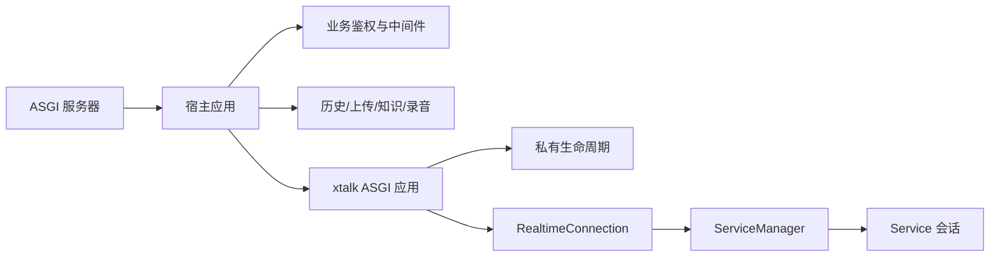

# 需求

- 开发者需要通过 xtalk 后端 SDK 配置模型并获得可部署的对话服务，接入任意支持 ASGI 的后端框架，而不必让 SDK 操作宿主框架的路由对象。
    - 可以独立部署 xtalk 应用。
    - 可以在已有异步服务中挂载 xtalk 应用。
- xtalk 只负责对话能力；业务用户鉴权、历史持久化、知识入库、文件上传和录音保存由宿主应用承担。
- 宿主需要明确的生命周期责任，保证启动、关闭与资源释放可预期。

# spec

- 应用入口。
    - `Xtalk.from_config()`、`Xtalk.configure().build()`、`Models` 与 `@model` 注册机制构建实例；一个实例对外提供一个模型名，默认 `xtalk`。
    - `Xtalk.create_asgi_app()` 返回标准 ASGI 应用（scope/receive/send），支持 HTTP、WebSocket 与 lifespan；无需传入宿主应用，不启动服务器、不监听端口、不重新加载模型；同一实例首次调用后缓存，再次调用返回同一对象。
    - SDK 不提供 `create_app`、`mount_routes`、`connect`、`asgi_lifespan`、`Xtalk.run()` 或 `xtalk[server]`；SDK 运行依赖不含 FastAPI 或其他 Web 框架，纯 SDK 环境可导入并运行 ASGI 应用；部署框架与 ASGI 服务器由使用者选择。
- 路由与路径。
    - 应用只提供 `GET /v1/models` 与 `WS /v1/realtime`，协议见 realtime-api.md；不接受 ws_path 等路径参数，不提供登录、会话列表、详情、上传、健康检查、CORS 或根静态页面。
    - 路径相对子应用根解释并正确处理 ASGI root_path：挂载于 `/xtalk` 时地址为 `/xtalk/v1/realtime?model=<model>`。
    - 宿主应在挂载子应用前注册自身路由；根路径挂载之后的宿主路由不保证可访问。宿主安全中间件需同时覆盖子应用的 HTTP 与 WebSocket 请求。
    - 支持直接 ASGI 部署与宿主提供的 ASGI 挂载，不支持直接挂载到 WSGI 应用。
- 生命周期。
    - 生命周期只通过返回应用的 ASGI lifespan 管理；独立部署由 ASGI 服务器驱动，挂载场景由宿主在自身 lifespan 中显式发送并等待 startup/shutdown（例如使用 asgi-lifespan 的 LifespanManager），普通挂载不自动转发。
    - lifespan 启动完成前 HTTP 返回 503、WebSocket 关闭，不按请求隐式启动后台资源；启动失败时不标记就绪并清理已启动任务。
    - 同一实例只允许一个活动生命周期所有者，嵌套或重复启动报错；关闭后不得重新启动，需要重启时创建新实例。
    - 正常关闭先停止接收新会话，再取消并等待活动会话任务、关闭连接及释放会话资源；复用模型 clone/reset 约定，不关闭仍由外部持有的模型资源。
- 对话与业务职责边界。
    - xtalk 不创建或写入聊天数据库、会话知识目录、持久化向量库或录音文件，不签发或验证业务用户凭证，不接收 user_id；废弃的用户鉴权及持久化配置报错，不静默生效。
    - xtalk 保留模型配置与加载、并发限制、连接取消与清理、对话内检索工具调用与结果注入、音频重采样与播放时间轴、日志与延迟指标；显式模型缓存与运行日志不属于业务持久化。
    - 宿主负责业务登录与权限、会话列表与详情、历史保存与通过 `conversation.item.create` 注入、文件上传与知识入库、基于客户端实际采集/播放音频的录音保存；宿主在 Realtime 握手进入子应用前验证业务凭证，无效凭证拒绝连接；业务凭证与可选 xtalk API Key 相互独立。
    - 外部按 Item ID 保存完成、取消及 `response.output_audio.playback.done` 结算结果，不只保存初始生成文本；重连注入更新后的文本历史，不恢复旧音频或未完成生成。
- 仓库内宿主。
    - `examples/sample_app` 的服务脚本先注册页面、静态与业务路由，再挂载 xtalk 应用并在 lifespan 中驱动其生命周期；业务登录、历史、上传、知识与录音由 `examples/sample_app/host` 实现，前端业务编排由 `static/js/business-api.js` 与 `conversation-store.js` 实现。
    - 桌面应用 `app/backend` 在自身适配层创建子应用、组合安全中间件与业务路由，子应用就绪后才报告 readiness，应用退出时关闭 xtalk 会话。

# 设计

```text
src/xtalk/
├── api.py                         # Xtalk、XtalkBuilder、create_asgi_app 与私有 ASGI 路由/生命周期
├── model_loader.py                # 配置到模型实例的加载
├── realtime/connection.py         # ASGI WebSocket 收发适配
└── serving/
    ├── interfaces.py              # 框架无关 Connection 协议
    ├── service.py                 # 不装配历史保存、知识入库与录音文件写入
    └── service_manager.py         # 临时会话创建与统一关闭
examples/sample_app/
├── configurable_server.py         # 宿主路由、生命周期与子应用挂载
├── mental_consultant_server.py    # 同上，咨询服务示例
├── custom_service.py              # 自定义服务集成示例
├── custom_model.py                # 自定义模型集成示例
├── custom_async_tool.py           # 自定义异步工具集成示例
├── host/                          # 示例业务鉴权、历史、知识与录音存储
└── static/js/                     # 示例业务 API、会话编排与页面逻辑
app/backend/
├── xtalk_adapter.py               # 创建 SDK 子应用
├── runtime.py                     # 组合生命周期、安全策略与业务路由
├── conversation_host.py           # 业务路由与 Realtime 连接组合
├── user_auth.py                   # 桌面业务凭证
├── conversation_store.py          # 业务历史存储
├── knowledge_store.py             # 上传与知识入库
└── recording_store.py             # 录音文件保存
```



- 路由构造与生命周期为 api.py 的私有实现，外部只调用 create_asgi_app；应用不管理宿主 app.state，不从宿主提取模型或凭证。
- Service、ServiceManager、SessionLimiter 与网关只依赖 Connection 协议，断开以统一内部结果表达，不传播框架异常。
- 本能力不包含 LLM 或深度学习提示词。
