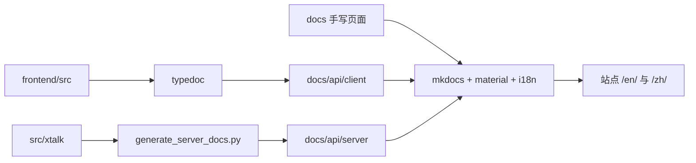

# 需求

- 读者需要按自己的处境找到文档。
    - 第一次接触 xtalk 的人跟着教程完成一个可运行的成果。
    - 带着明确任务的人直接查操作步骤。
    - 有经验的人查接口与配置事实。
    - 想深入的人读设计原理与运行机制。
- 每个页面只承担一种职责，读者打开前就能预期它给出什么。
- 文档站保持中英双语，两种语言内容等价。
- `README.md` 独立维护，不属于文档站。

# spec

- 文档分区（`docs/`）。
    - 页面按 Diátaxis 四类组织在 `tutorial/`、`how_to/`、`reference/`、`explanation/` 下；`index.md`、`quickstart.md` 位于根目录；`api/` 存放由脚本生成的 API 文档，导航上归入 Reference。
    - 每个页面只属于一类；同时包含操作步骤、参数事实和原理讨论的内容拆成多个页面并互相链接。
    - 每个页面以一级标题开头，标题与 `mkdocs.yml` 导航标签一致。
    - 每个页面以 Next Steps 卡片区结尾，使用 `<div class="grid cards next-step-cards" markdown>` 结构，每张卡片一个链接，只推荐相关页面，最推荐的放第一项。
    - 不保留旧路径、重定向、旧名称对照或迁移说明。
- 双语。
    - 英文页面以 `.md` 结尾，中文页面以 `.zh.md` 结尾，前缀相同且位于同一目录。
    - 两种语言的页面标题层级一致、事实一致；中文页面的链接指向 `.zh.md` 对应页。
    - 导航标签通过 `mkdocs.yml` 的 `nav_translations` 翻译，每个英文标签都有中文条目。
- Tutorial（`tutorial/`）。
    - 页面分三组串成学习路径，组内后一篇默认读者已完成前一篇。
        - Basics：Start the Service → Configure the Service → Connect a Client。
        - Extend the Service：Introduce a New Model → Introduce an LLM Agent → Attach Tools → Customize the Service → Bot2Bot。
        - Desktop App：Model Configuration → Add Tools。
    - 开头一段说明本篇最终产出的可运行成果与前置条件，前置条件链接到前一篇教程或 Quickstart。
    - 每个步骤说明目的，执行后给出可观察的结果。
    - 会先出现、再被后续步骤修复的报错，在报错出现前说明其为预期行为。
    - 不影响当前操作与结果判断的实现机制移至 Reference 或 Explanation 并链接。
- How-to（`how_to/`）。
    - 开头一句说明完成的任务与前提，正文直接给出操作，理论内容以链接指向 Reference 或 Explanation。
    - 页面：Mount in FastAPI、Deploy Fully Local、Adapt Async Models、Logging、Testing、Text Input，以及 `desktop_app/` 下的 Web Search、Voice Wake。
    - Adapt Async Models 为每种模型类型（ASR、离线 ASR、TTS、VAD、Turn Detector、Speech Enhancer）给出完整可注册的适配类，含全部抽象方法、同步包装、`clone`/`reset` 与配置片段。
- Reference（`reference/`）。
    - 页面按接口签名、简短描述、参数、返回值、异常、示例的顺序组织。
    - 页面：Service Configuration、Client Session Config、Realtime API Protocol、Supported Models、Model `clone()` and `reset()`、Tools、Audio Bridge，以及 `models/` 下每种模型接口（ASR、TTS、VAD、Turn Detector、Speech Enhancer、Forced Aligner）。
    - 模型接口页面的 Next Steps 第一项指向对应 Explanation 页面（ASR 指向 Adapt Async Models），第二项指向 Introduce a New Model。
- Explanation（`explanation/`）。
    - 页面讨论设计取舍与运行机制，不包含操作步骤。
    - 页面：Overall Architecture，以及 VAD、TTS、Speech Enhancer、Turn Detection、Forced Alignment、Audio Bridge 的流程与模型说明。
- 站点配置（`mkdocs.yml`）。
    - 导航顶层顺序：Home、Quickstart、Tutorial、How-to、Reference、Explanation；Reference 末尾包含 API 子组（Client、Server）。
    - 使用 Material 主题与 `i18n` 插件（`docs_structure: suffix`），`exclude_docs` 排除 `docs/README.md` 与 `docs/AGENTS.md`。
    - `toc` 使用 `pymdownx.slugs.slugify` 生成锚点，使中文标题可被链接。
    - `extra_css` 加载 `stylesheets/extra.css`，其中定义 Next Steps 卡片整体可点击的样式。
    - `mkdocs build --strict` 无警告。

# 设计

```text
docs/
├── index.md                      # 首页：产品说明与四分区入口卡片
├── quickstart.md                 # 用云端模型跑通第一次对话
├── AGENTS.md                     # 文档写作约定（不构建）
├── README.md                     # API 文档生成说明（不构建）
├── generate_server_docs.py       # 生成 api/server/
├── requirements.txt              # 文档构建依赖
├── stylesheets/extra.css         # Next Steps 卡片样式
├── tutorial/                     # 学习路径
│   ├── start_the_service.md
│   ├── config_the_service.md
│   ├── connect_a_client.md
│   ├── introduce_a_new_model.md
│   ├── introduce_an_llm_agent.md
│   ├── attach_tools.md
│   ├── customize_the_service.md
│   ├── bot2bot.md
│   └── desktop_app/              # 桌面应用教程
├── how_to/                       # 单一任务的操作指南
│   ├── mount_in_fastapi.md
│   ├── deploy_fully_local.md
│   ├── adapt_async_models.md
│   ├── logging.md
│   ├── testing.md
│   ├── text_input.md
│   └── desktop_app/              # 桌面应用操作指南
├── reference/                    # 接口与配置事实
│   ├── service_config.md
│   ├── client_session_config.md
│   ├── realtime_api.md
│   ├── supported_models.md
│   ├── model_clone_reset.md
│   ├── tools.md
│   ├── audio_bridge.md
│   └── models/                   # 每种模型接口一页
├── explanation/                  # 设计取舍与运行机制
│   ├── system_design.md
│   ├── vad.md
│   ├── tts.md
│   ├── speech_enhancer.md
│   ├── turn_detector.md
│   ├── forced_aligner.md
│   └── audio_bridge.md
└── api/                          # 生成的 API 文档
    ├── client/                   # typedoc 输出
    └── server/                   # generate_server_docs.py 输出
mkdocs.yml                        # 导航、i18n、锚点与样式配置
```

每个 `.md` 均配有同名 `.zh.md`。



- 本能力不包含 LLM 或深度学习提示词。
