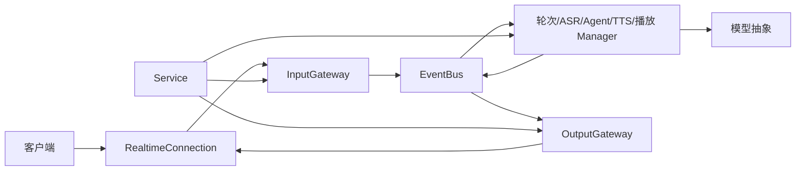

# 需求

- 客户端开发者需要使用 OpenAI Realtime 形式的接口与 xtalk 进行实时文本和语音对话，并明确可用能力及兼容范围。
    - 支持文本输入、音频输入和流式回复。
    - 支持手动控制轮次及自动检测讲话结束。
    - 支持取消回复和用户插话，后续对话只使用用户实际听到的内容。
- xtalk 只负责当前会话的对话能力，业务用户、长期历史及其存储由外部应用负责。
- 开发者需要在不修改框架内部的情况下扩展输入和输出事件。

# spec

- 连接与会话。
    - 提供 `GET /v1/models` 和 `WS /v1/realtime?model=<name>`；模型列表只返回本实例的对外模型名，`model` 省略时使用 `service_config.realtime_api.model`（缺省 `xtalk`），显式提供未知模型在创建会话前拒绝连接。
    - 可选 API Key 访问控制：`realtime_api.api_keys` 缺省或为空列表时无需凭证；非空时 HTTP 与 WebSocket 在创建会话前验证列表中任意一个 Key，服务端客户端使用 `Authorization: Bearer <key>`，浏览器使用 `openai-insecure-api-key.<key>` 子协议；缺失或错误凭证拒绝访问，不记录原始 Key。客户端在握手中提供 `realtime` 子协议时服务端选中它（使提供子协议的 WebSocket 客户端握手成功），未提供时不选中任何子协议。不提供 `/v1/realtime/client_secrets`，短期凭证由外部应用签发与验证。
    - 连接获准后主动发送 `session.created`；每条连接拥有独立的临时 Session 与 Conversation，不读取数据库、不按 session_id 恢复，断开即释放运行状态；外部通过 `conversation.item.create` 按顺序注入历史。
    - 会话并发限制沿用 FIFO 准入：排队时发送 `session.queue.updated`（顶层 `position`、`limit`、`active`，首次及每 5 秒），获准发送仅含 type/event_id 的 `session.queue.granted`，初始化完成后才发送 `session.created`。
- 会话配置。
    - `session.update` 支持 `type`（仅 `realtime`）、`instructions`、`output_modalities`（`["audio"]` 或 `["text"]`）、`audio.input.format`、`audio.input.transcription`、`audio.input.turn_detection`、`audio.output.format`、`audio.output.voice`、`audio.output.speed`、`audio.output.emotion` 及 `session.xtalk` 下的持续扩展配置；省略字段保持原值，成功后以 `session.updated` 回显完整有效配置，`session.created` 同样回显完整配置。
    - 输入输出格式固定为 `{"type":"audio/pcm","rate":24000}`；转写缺省为对外模型名，设为 `null` 只关闭外部转写事件，内部 ASR 继续运行。
    - `turn_detection` 接受 `null` 或 `server_vad`，后者包含 `threshold`、`prefix_padding_ms`、`silence_duration_ms`、`create_response`、`interrupt_response`，默认 `{threshold:0.5, prefix_padding_ms:300, silence_duration_ms:500, create_response:true, interrupt_response:true}`；阈值更新需要模型支持。
    - `voice` 缺省 `default`，首次音频输出后仍可修改（xtalk 扩展），生效时机沿用 TTS 音色更新机制；`speed` 缺省 1.0，范围 0.25–1.5，活动回复期间可修改（xtalk 扩展），已处理音频不重新处理。
    - `emotion` 为 xtalk 扩展 `{name, vector}`：name 非空时优先于 vector，两者均空返回参数错误且保留原值。
    - 校验在网关边界完成：类型、必填、枚举与数值范围随 `serving/events.py` 的类型定义严格校验，不隐式转换字符串或布尔值，拒绝非有限数。全部组合参数校验及能力预检成功后才应用，只应用实际变化字段；任一失败返回 `error` 且不发送 `session.updated`，已成功生效的部分保留快照，不承诺跨模型回滚。
    - 不支持会话内切换 LLM/TTS 模型：`change_llm_model`、`change_tts_model` 事件及 `session.xtalk.llm_model/tts_model` 字段明确拒绝，不影响当前模型、上下文和活动任务。
- 音频输入与轮次。
    - 输入为 24 kHz 单声道 signed PCM16 little-endian 原始音频，不含 WAV 头；`input_audio_buffer.append`（Base64）与裸 PCM 二进制消息（xtalk 扩展，默认开启）等价，可在同一连接按接收顺序混用，共享重采样、缓冲及轮次处理；append 不逐包确认、不隐式 commit。
    - 单条消息最大 1 MiB（JSON 按 UTF-8 字节、二进制按 PCM 字节），两种输入共享 60 秒输入缓冲，提交或完成轮次后释放；空缓冲 commit、非法 Base64、奇数字节及超限输入返回错误且不改变已有缓冲与重采样状态，非法二进制输入的 `error.event_id` 为 null，连接保持可用。
    - `input_audio_buffer.commit` 创建 input_audio Item、发送 `input_audio_buffer.committed` 并清空缓冲，启动转写并交由轮次机制决定是否回复；`input_audio_buffer.clear` 清空未提交缓冲、重置重采样与手动讲话状态，并发送 `input_audio_buffer.cleared`。
    - `server_vad` 模式下讲话开始与结束发送 `input_audio_buffer.speech_started/stopped`（保留 `origin`，非 server VAD 来源属于 xtalk 扩展语义），结束时自动提交，仅在 `create_response` 为 true 时生成回复；`interrupt_response` 为 false 时讲话不打断当前回复。
    - `turn_detection: null` 时音频缓冲直至客户端发送 xtalk 扩展 `input_audio_buffer.speech_start`（启动 ASR 并回放已缓冲音频，可选毫秒 `timestamp`）或 `commit`；commit 后仍沿用 xtalk 自动轮次回复。
    - 纯音频客户端只发送 append 时，server_vad 自动轮次必须正常工作；speech_start/commit 为可选扩展路径。
- 输入 Item 与转写。
    - `conversation.item.create` 接受 user/system 的 `input_text` 与 assistant 的 `text` 消息；客户端提供的 item ID 在 Conversation 内唯一，重复返回错误；返回 `conversation.item.added/done`。
    - 默认只注入上下文、不生成回复，且不经过会自动回复的 Agent 路径；仅 user 消息在事件顶层携带 `xtalk.generate_response=true` 时作为实时文本轮次自动回复，文本非空白且不超过 8192 UTF-8 字节，非 user 消息不允许该标记。实时文本不伪装为转写，不产生转写事件。
    - 音频输入 item_id 在轮次打开时按 `item_input_{session_id}_{turn_id}` 分配一次，同轮多个片段复用，结束或中止后下一轮使用新 ID；ASR 部分、最终、失败、提交及通知均使用该 ID。
    - ASR 预览使用 `conversation.item.input_audio_transcription.delta`，始终包含 `delta`、`xtalk.mode`、`xtalk.revision`：新文本以旧文本为前缀时 mode=append、delta 为新增后缀，否则 mode=replace、delta 为完整新文本；首次按旧文本为空处理，文本不变可跳过，清空发送 replace 与空 delta；revision 按 Item/content_index 单调递增。纯追加式标准客户端不能直接兼容此语义。
    - 最终转写使用 `...transcription.completed`（完整 `transcript`），失败使用 `...transcription.failed` 且不关闭连接；转写与 Response 异步推进，不保证二者之间的全局顺序。
- Response 生成。
    - 不支持 C→S `response.create`，返回 `unsupported_event` 且不启动生成；回复只由音频轮次或带 generate_response 的用户文本触发。
    - 同一输出内容的事件顺序为 `response.created` → `response.output_item.added` → `response.content_part.added` → delta/done → `response.content_part.done` → `response.output_item.done` → `response.done`；索引从零开始，所有增量携带 response_id 与 item_id；当前一回复一输出 Item，输出 item_id 由 response_id 确定性生成。
    - 文本模式使用 `response.output_text.delta/done`；音频模式使用 `response.output_audio.delta/done`（默认 Base64，二进制扩展见 realtime-audio-output.md）与 `response.output_audio_transcript.delta/done`。
    - 音频转写只描述已合成内容：分句 TTS 按每个成功合成的句子追加；流式 TTS 在整轮合成成功后发送一次完整文本 delta，再以同一文本发送 done；中途取消或失败时不以已接受但未确认合成的文本作为转写，分句与整轮汇总不重复追加。
    - `response.done` 是生成终态，status 为 completed、cancelled、failed 或 incomplete，每个 Response 恰好一次；音频模式在文本与音频生成都结束后才 completed，不等待播放确认。
    - `response.cancel` 取消指定或当前活动 Response，迟到结果不进入后续回复；无可取消 Response 返回错误并保持连接。
- 播放确认与打断结算（xtalk 扩展）。
    - 音频投递受未确认音频预算约束：客户端在每个原始音频块实际播放后发送 `response.output_audio.playback.chunk_played {response_id}`，全部播放后发送 `...playback.finished`；未确认音频达到预算时暂停投递，缺少确认会阻塞后续音频。不提供无需确认的投递路径，不新增周期进度、块序号或累计位置字段。
    - 服务端发送 `...playback.pause/resume/stop {response_id}` 控制播放；stop 后客户端清空该 Response 队列，并以 `...playback.stopped {response_id, played_audio_ms}` 回报自上次确认以来的未确认已播放增量；超过 `forced_alignment.stop_ack_timeout_ms`（缺省 500）未回报时按已确认内容结算。
    - 服务端以 `...playback.updated {response_id, text}` 发送实际已播放文本的完整快照，以 `...playback.done` 发送最终结算；该结算文本写入后续对话上下文，与生成文本 delta/done 分开。
    - 不支持 `conversation.item.truncate`，返回 `unsupported_event` 且不改变上下文；仅使用标准事件的客户端不具备打断结算能力，文档明确此限制。
- 通知扩展（均为完整快照或瞬时通知，带唯一 event_id）。
    - `conversation.caption.updated {text, is_final, reason}`、`conversation.retrieval.updated {text, is_final}`：替换展示，不拼接；检索结果来自服务端检索工具。
    - `conversation.speaker.updated {speaker_id, reason}`：说话人识别通知。
    - `response.tool.called {name, args}`：后端工具调用通知，工具仍在服务端执行，不映射为客户端 function_call；`tool_call_result` 与 `direct_audio` 不发送；不保证关联某个 Response。
    - `session.latency.updated`：顶层 `network_latency_ms`、`asr_latency_ms`、`llm_first_token_ms`、`llm_sentence_ms`、`tts_first_chunk_ms`，整数毫秒；无客户端测量时沿用缺失值处理，不提供时钟同步。
    - `session.audio.mix.delta {delta, sample_rate, channels, format}`：`send_full_audio_to_client` 开启时的会话混合音频，与单个 Response 音频分开，文件保存由外部负责。
- 错误与健壮性。
    - 服务端事件均有唯一 event_id；客户端 event_id 可选，不作为重试幂等键。
    - 错误以 `error` 事件返回 `error.type`（`invalid_request_error` 或 `server_error`）、`code`、`message`、`param`、`event_id`（关联客户端事件，无法提取时为 null）；未预期执行异常记录日志并返回不暴露内部细节的 server_error；连接继续可用。
    - 无效 JSON、未知事件（`unsupported_event`）及不支持的字段不断开连接；`ping`、`pong`、`clock_sync` 不支持。发送队列按字节设上限并保序，持续慢客户端超限时关闭该连接并清理资源。
    - 接收循环与音频投递任务分离，投递等待块确认时仍能处理确认与取消。
- 自定义输入输出事件。
    - `Service.register_input_handler(*, type, handler)` 按外部 type 分发，handler 接收当前 InputGateway 与已解析消息，可通过 `gateway.event_bus.publish` 发布内部事件；错误转换及 event_id 关联由网关统一处理。
    - `Service.register_output_handler(*, source_event, type, handler)` 订阅内部事件，handler 同步或异步返回载荷字典，返回 None 不发送；网关补充 type/event_id 并进入统一发送队列，载荷不得覆盖这两个字段。
    - 输入以 type 为键、输出以 (source_event, type) 为键，后注册替换前注册且不重复执行，内置处理器同样适用；注册配置随 Service.clone 复制，每个会话使用自己的网关。
    - `subscribe_event/unsubscribe_event` 与公共 `OutputGateway.send_signal()` 保留；send_signal 接收完整外部事件字典，缺少 event_id 时补齐。
- 范围外能力。
    - 不提供 WebRTC、SIP、客户端函数调用闭环、MCP、out-of-band Response、Item 删除/查询、音频历史注入、原生推理信息或完整 OpenAI SDK 兼容承诺。
    - 除裸 PCM 输入与 realtime-audio-output.md 的二进制输出外，扩展只对应既有能力与字段；持续配置位于 session.update/updated，瞬时事件独立发送，不以配置回显触发命令。

# 设计

```text
src/xtalk/
├── api.py                                   # 固定 Realtime 路由与连接入口
├── realtime/
│   ├── __init__.py                          # 包边界，不反向导入 Xtalk/Service
│   ├── config.py                            # realtime_api 配置校验，仅 model/api_keys
│   ├── auth.py                              # 可选 API Key 校验
│   ├── protocol.py                          # 兼容导出协议类型与处理器类型契约
│   └── connection.py                        # ASGI 收发适配、有序有界发送队列与关闭
└── serving/
    ├── events.py                            # 内部事件及全部输入输出消息形状与约束
    ├── event_bus.py                         # 观察者事件总线及单消费者 request
    ├── interfaces.py                        # Manager 基类与框架无关 Connection 协议
    ├── service.py                           # 组装 Manager、网关及输入输出注册
    ├── service_manager.py                   # 临时会话、任务与资源所有权
    ├── session_limiter.py                   # FIFO 并发准入与排队通知
    └── modules/
        ├── input_gateway.py                 # 输入校验、转换、配置协调及分发
        ├── output_gateway.py                # Realtime 事件构造、编码与发送
        ├── turn_taking_manager.py           # 轮次、输入 item_id 分配与插话
        ├── asr_manager.py                   # 转写、预览修订及 Item 关联
        ├── llm_agent_context_manager.py     # 历史注入、实时输入及上下文同步
        ├── llm_agent_generation_manager.py  # 生成任务、response_id 与终态
        ├── tts_manager.py                   # 合成、音频投递与未确认预算
        ├── tts_response_coordinator.py      # 单回复投递协调
        └── tts_playback_manager.py          # 播放确认、对齐与停止结算
```



- serving 是唯一对话运行时，不另建 Session/Response 状态引擎或 Conversation 管理层；生成终态归生成 Manager，合成与预算归 TTSManager，投递协调归 TTSResponseCoordinator，播放与结算归 TTSPlaybackManager，网关只消费状态变化。
- 依赖方向为 api → realtime 适配与 Service、网关 → 协议类型与内部事件；除网关外的 Manager 只依赖内部事件与模型抽象，不导入 Realtime 消息形状；Service、Gateway 不引用任何 Web 框架类型。
- 内置事件与自定义事件使用同一注册机制：Service 在原型初始化时以未绑定方法注册内置输入处理器，网关执行时以当前会话网关调用；输入网关不反向导入 Service。
- Agent 通过窄能力接口支持历史注入、会话指令与播放结算同步；不具备能力的实现在使用时返回错误。
- 客户端 instructions 作为会话级指令送入 Agent；本能力不包含固定 LLM 提示词。
