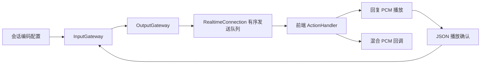

# 需求

- 客户端开发者需要选择更节省带宽和编解码开销的音频输出，同时准确关联回复与播放状态。
- 未启用扩展的客户端需要继续使用现有音频协议，不受新增传输方式影响。

# spec

- 输出编码由会话显式协商。
    - session.update 的 session.xtalk.output_audio_encoding 接受 base64 和 binary_pcm；新会话默认 base64，session.created/updated 回显完整有效值，省略该字段保持原值。
    - binary_pcm 为 Xtalk WebSocket 扩展，不宣称 OpenAI 标准客户端支持；客户端收到 session.updated 确认后才能依赖二进制输出。未知值返回 invalid_value，不修改会话有效状态。
    - 有未结束的 Response 或尚未结算的输出播放块时拒绝更改编码，返回 invalid_value；重复设置当前值允许。编码更新与输出入队串行化，确认前的消息使用旧编码，确认后的新音频使用新编码；已经入队的消息不改写。
- 音频块采用互斥编码。
    - base64 模式保留 response.output_audio.delta 和 session.audio.mix.delta 的 JSON Base64 delta；binary_pcm 模式以二进制消息替代这两种音频 delta，不再发送对应 Base64 JSON，不为同一块发送第二份载荷或额外 JSON 头事件。
    - response.output_audio_transcript、音频完成、Response 生命周期、错误、播放控制和客户端块确认继续使用现有 JSON 事件；音频编码选择不改变音频生成、分块、取消、播放结算或上下文行为。
    - 输入方向仍沿用 Realtime 协议的 JSON Base64 与裸 PCM 二进制输入规则，不使用输出消息封装，不根据输出编码改变输入解析。
- 每条二进制 WebSocket 消息封装一个完整音频块。
    - 消息由 4 字节无符号大端头长度 N、N 字节 UTF-8 JSON 对象头、剩余 PCM 载荷组成；N 为字节长度，范围 1 至 65536。按 WebSocket 完整消息解析，不依赖底层帧的拆分边界。
    - 头部 version 固定为 1，type 分别为 xtalk.output_audio.delta 或 xtalk.audio.mix.delta，event_id 沿用服务端事件唯一标识；头部不含 delta 或 Base64 音频字段。
    - 回复音频头保留现有 response.output_audio.delta 的 response_id、item_id、output_index、content_index 和 xtalk 块播放确认元数据；PCM 保持会话确认的 audio.output.format，首期为 24 kHz、单声道 signed PCM16 little-endian，不含 WAV 头。
    - 混合音频头保留原 session.audio.mix.delta 的 sample_rate、channels 和 format，PCM 按这些元数据解释；不关联单个 Response，不新增 Item ID、sequence、时间位置或 done 事件。仅支持现有 PCM16 混合输出，其他格式不冒充 PCM。
- 客户端按消息类型解码并复用播放管线。
    - 文本消息按 JSON 解析，Base64 音频事件按原路径解码；二进制消息验证头部长度、JSON 对象、version、type、必需关联字段和 PCM16 样本对齐，按头部区分回复播放与混合音频消费。
    - 未确认 binary_pcm 却收到二进制音频、未知版本或类型、非法头部或 PCM 载荷时视为协议错误：停止接收和播放该连接的后续音频并关闭连接，不猜测为裸 PCM 或 Base64，不发送成功播放确认。
    - 正常二进制块进入现有原始 PCM 播放入口，不为复用旧处理器重新 Base64 编码；取消、迟到块过滤和播放完成确认复用现有块身份。
- 验收覆盖兼容性与传输一致性。
    - 默认连接保留 Base64 JSON；协商成功后仅发送二进制音频，回复与混合音频逐块解码所得字节及元数据与 Base64 模式一致，转写和控制事件仍为 JSON。
    - 覆盖编码确认顺序、活动回复及未结算播放期间拒绝切换、非法配置不修改状态、两种输入方向不受影响、多会话编码隔离，以及非法二进制消息的关闭行为。
    - 覆盖文本与二进制共用发送顺序、八 MiB 队列预算、过载关闭、断线清理、块确认和中断结算；记录同一 PCM 样本两种模式的实际消息大小及编解码耗时，不承诺固定延迟收益。

# 设计

```text
xtalk/
├── src/xtalk/
│   ├── serving/events.py                      # 输出编码配置与二进制头类型契约
│   ├── serving/interfaces.py                  # Connection 增加 send_bytes，移除公开 send_text
│   ├── serving/modules/input_gateway.py       # 输出编码协商，清理依赖 send_text 的旧 pong 路径
│   ├── serving/modules/output_gateway.py      # 选择编码、生成二进制头并复用块身份
│   ├── realtime/protocol.py                   # 兼容导出新增协议类型
│   └── realtime/connection.py                 # 文本和二进制共用有界有序发送队列
└── frontend/src/
    ├── action-handler.ts                      # 按文本或二进制解析和分发完整消息
    ├── session/types.ts                      # 公开 outputAudioEncoding 配置
    ├── session/create.ts                     # 将编码选择交给协议处理器
    ├── session/runtime.ts                    # 连接打开时重置通用处理器状态
    └── action-handler-functions/
        ├── protocol.ts                        # 输出编码及二进制头类型
        ├── input.ts                           # 二进制混合音频回调
        ├── output.ts                          # 二进制回复块接入现有 PCM 播放
        └── session.ts                         # 协商确认及混合音频消费
```

- 在现有协议类型定义位置增加输出编码与二进制头契约；Python 使用 serving/events.py 的现有协议定义，realtime/protocol.py 仅保留兼容导出，不新建第二套协议分发系统。
- Connection 仅公开 accept、receive、send_json、send_bytes 和 close，不公开 send_text。
    - send_json 接收结构化 JSON 消息，RealtimeConnection 内部完成序列化及文本入队；通用入队实现使用私有方法，不要求调用方先序列化。
    - send_bytes(data: bytes) 仅负责二进制传输，音频封装属于 OutputGateway；文本和二进制统一按实际载荷字节数计入既有八 MiB 预算并保持入队顺序。
    - 不为应用层 ping/pong 单独保留 send_text；按 Realtime 协议不支持应用层 ping/pong 的约定删除遗留 pong 序列化发送路径，不借此新增 ping/pong 能力。结构化控制事件统一调用 send_json；WebSocket 传输层 ping/pong 由传输栈处理。
    - 更新连接测试替身与调用方，验证公开接口不再依赖 send_text，JSON 序列化及有序发送行为保持一致。
- OutputGateway 在既有回复和混合音频输出入口选择编码，共用既有 PCM 转换及事件 ID 生成路径；不通过先 Base64 编码再解码得到二进制载荷。
- 前端协议处理位于 ActionHandler 和现有处理器，session/runtime 保持通用消息转交；浏览器 binaryType 与必要的 Blob 转 ArrayBuffer 操作仅在 frontend/src/platforms 内实现，跨平台代码只依赖现有平台抽象及 Web-first 类型。
- 在 tests/realtime/test_connection.py、test_output.py 和输入配置测试补充后端验证，在 frontend/tests 补充协商、二进制解析、播放和异常测试；更新 docs/technical_reference/realtime_api.md 与 realtime_api.zh.md，说明：如何启用并等待协商确认、按 WebSocket 消息类型识别音频编码、解析二进制头及 PCM 载荷、关联回复/混合音频、复用播放与块确认，以及处理非法消息；同时说明默认 Base64 兼容行为及两种编码互斥。两份协议文档保持一致。本变更不修改模型、提示词或推理逻辑，不要求新增独立示例客户端。


