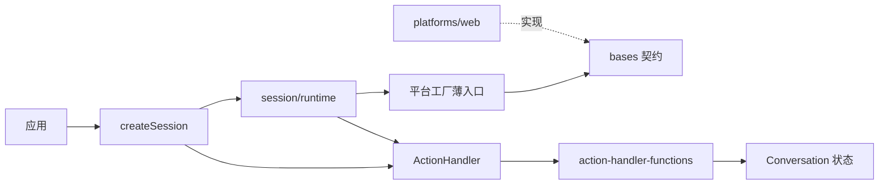

# 需求

- Web 开发者需要一个客户端库连接 xtalk Realtime 服务，完成音频采集、播放、文本输入与对话状态展示，无需自行实现协议细节。
- 设备端开发者需要一个最小终端客户端示例，演示仅用 WebSocket 与声卡完成语音对话。
- 客户端库只提供对话连接与状态，业务登录、历史与上传由应用自行完成。

# spec

- 客户端库公共接口（`xtalk-client`）。
    - `createSession(url, config?)` 以应用提供的 WebSocket URL 为连接目标，不执行登录、不附加业务凭证、不覆盖挂载前缀；`SessionConfig` 包含 `outputAudioEncoding`（`base64` 缺省或 `binary_pcm`）、`inputConfig`、`outputConfig` 与可选 `apiKey`。
    - `Session` 提供 `open()`、`close()`、`state`、`onStateChange(cb)`、`onInputAudioChunk(cb)`、`onOutputAudioChunk(cb)`、`onFullAudioChunk(cb)`、`muted`、`sendText(text)`、`changeVoice(name)`、`restoreHistory(messages)`。
    - `apiKey` 通过 `openai-insecure-api-key.<key>` 子协议传递，不写入 URL、日志或快照；业务 token 由应用附加到 URL，库不将其当作 API Key。
    - `createAudioBridge()` 提供 Web 端多会话共享音频总线（见 bot2bot 教程），会话通过 `inputConfig.mode = "web_bridge"` 接入。
- 平台扩展点。
    - `registerPlatformRuntime(runtime: PlatformRuntime): void` 是主入口受支持的平台扩展点：注册后所有平台工厂使用该运行时，不再进行浏览器环境探测；未注册时保持浏览器探测；应在创建 Session 前调用，重复调用以最后一次注册为准，已创建 Session 持有的平台对象不变。
    - 主入口导出 `PlatformRuntime` 类型、`BaseWebSocket`、`BaseInputAudioSession`、`BaseOutputAudioSession`、`BaseEncoding`、`BaseDeferredTaskScheduler` 及其配置类型，供外部平台实现继承。
    - 导入主入口不触碰平台：平台对象在首次使用时创建。
- 连接握手。
    - `open()` 等待 WebSocket 打开，处理可能先到达的 `session.queue.updated/granted`，等待 `session.created` 后发送 `session.update`（含请求的输出编码），等待 `session.updated` 确认；确认前收到 `error` 时 `open()` 拒绝。
    - 握手成功后按顺序发送 `restoreHistory` 排队的历史 Item（每条等待对应 `conversation.item.done`，不触发生成），再打开输出与输入音频，`connectionState` 变为 `connected`。
- 音频输入。
    - 输入帧不论本地 VAD 状态持续以 Base64 `input_audio_buffer.append` 发送，采集音频转换为 24 kHz PCM16；`muted` 为真时停止发送帧与本地讲话通知，跨 close/open 保留。
    - 本地讲话开始发送 `input_audio_buffer.speech_start`，结束发送 `input_audio_buffer.commit`，不发送 `response.create`；服务端 `speech_started/stopped` 只更新状态，不回发。
    - 麦克风模式 `inputConfig.enableVAD` 与 `enableEnhancer` 默认 true，作为初始化配置：VAD 开启时上传原始音频并本地检测边界（Enhancer 开启时增强音频只用于检测链路）；VAD 关闭且 Enhancer 开启时上传增强音频、不产生本地边界；两者关闭时上传原始音频、不产生本地边界。Enhancer 加载或推理失败降级关闭并继续处理音频。
- 文本与配置操作。
    - `sendText` 去除首尾空白，空文本抛错；发送带 `xtalk.generate_response=true` 的 user `conversation.item.create`，在对应 `conversation.item.done` 后 resolve，收到关联 `error` 时 reject；连接关闭时拒绝所有待完成请求。
    - `changeVoice` 发送 `session.update` 的 `audio.output.voice`。
- 音频输出与播放确认。
    - `response.content_part.added`（音频 part）建立该 Response 的播放流；其他或已退役 Response 的音频增量丢弃；Base64 与已协商的二进制音频进入同一原始 PCM 播放入口并保持原块边界，二进制解析与协议错误处理见 realtime-audio-output.md。
    - 每块实际播放完成发送一次 `response.output_audio.playback.chunk_played`，零长度块不确认；`response.output_audio.done` 后全部播放完成发送一次 `...playback.finished`，`streamState` 回到 `idle`。
    - `...playback.stop` 退役该 Response、停止播放并清空队列，发送携带未确认已播放增量毫秒数的 `...playback.stopped`；`...playback.pause/resume` 暂停与恢复播放；接收与播放并发，不因等待播放而阻塞网络接收。
- 对话状态。
    - `state` 包含 `connectionState`、`streamState`、`sessionId`、`messages` 及元信息字段（`tool_call`、`thought`、`caption`、`retrieval`、`latency`）；`onStateChange` 注册时立即回调当前状态，之后每次顶层状态变更回调。
    - 用户消息按 item_id/content_index 关联，应用 ASR append/replace 修订并忽略过期 revision，completed 后忽略迟到预览，failed 时添加提示消息。
    - 助手消息分别保存生成内容（`response.output_text.*`、`response.output_audio_transcript.*`）与播放确认文本（`...playback.updated/done` 按 response_id 替换）；`response.done` 不提前结束 speaking 状态。
    - caption、retrieval、thought（`conversation.thought.updated`，仅前端接收能力）以完整快照替换，`response.tool.called` 替换 tool_call 对象，混合音频调用 `onFullAudioChunk`；`error` 结算待完成消息并添加提示；未知事件忽略且不导致连接失败。
- 终端示例客户端 `examples/sample_client.py`。
    - CLI 必填 `--base-url` 与 `--model`，可选 `--api-key`、`--input-wav`、`--no-speaker`、`--rounds`、`--timeout`、`--trace-events` 及插话参数；base_url 接受 http/https/ws/wss 根地址与挂载前缀，转换为 ws/wss 并追加 `/v1/realtime`；api_key 仅通过 `Authorization: Bearer` 传递，不输出或拼入 URL。
    - 建立单个 Session，等待 `session.created` 后通过 `session.update` 配置音频输出与 server_vad 自动轮次，再持续 append 麦克风或 WAV 音频；不发送 speech_start、commit 或 response.create，不加载本地 VAD/Enhancer/ASR/TTS，不调用业务接口、不保存录音或历史、不提供文本输入。
    - 保持一个输出流连续填充协议块，块的最后样本到达输出设备后才确认，实现播放完成、暂停/恢复与停止增量回执；`--no-speaker` 以按音频时长消费的输出替代声卡。
    - Ctrl+C、断线、缺少声卡或依赖、认证失败时给出可操作提示并释放声卡、连接与任务；不提供重连或多 Session。

# 设计

```text
frontend/src/
├── index.ts                         # 公共入口：createSession、createAudioBridge、registerPlatformRuntime、bases 抽象类与类型
├── conversation.ts                  # 对话状态、Item 关联与播放展示
├── action-handler.ts                # 唯一消息分发器：解析文本/二进制、编码协商、请求等待
├── session/
│   ├── create.ts                    # 对话编排与公开操作
│   ├── runtime.ts                   # WebSocket/音频生命周期与握手协调
│   └── types.ts                     # Session、SessionConfig 等公共类型
├── action-handler-functions/
│   ├── index.ts                     # 处理器注册入口
│   ├── protocol.ts                  # 全部网络事件形状与协议共用类型
│   ├── handler-types.ts             # 处理器签名与映射类型
│   ├── session.ts                   # Session 配置与运行标识
│   ├── messages.ts                  # Item、ASR 修订、生成与播放文本、错误
│   ├── output.ts                    # 音频输出与播放控制
│   ├── input.ts                     # 服务端讲话通知与混合音频（编码器首次使用时创建）
│   ├── client.ts                    # 本地音频帧、讲话边界与块确认转网络消息
│   ├── client-operations.ts         # 文本、历史恢复与音色操作
│   ├── meta.ts                      # 完整快照与工具通知
│   ├── latency.ts                   # 延迟指标
│   └── utils.ts                     # 共用状态转换
├── audio-session.ts                 # 音频会话平台工厂薄入口
├── websocket.ts                     # WebSocket 平台工厂薄入口
├── encoding.ts                      # 编码平台工厂薄入口
├── task-scheduler.ts                # 延迟任务调度平台工厂薄入口
├── bases/                           # 平台无关的 WebSocket、音频、编码与调度契约
└── platforms/
    ├── index.ts                     # 已注册运行时优先，否则平台探测与运行时装配
    ├── web.ts                       # 浏览器 WebSocket、音频、VAD/Enhancer 实现
    └── web-audio-bridge.ts          # Web 共享音频总线
examples/
└── sample_client.py                 # 终端单 Session 语音客户端
```



- 浏览器 WebSocket、URL 凭证子协议、设备、音频图、模型与缓存操作限定在 `frontend/src/platforms`，其他目录只依赖 bases 契约与 Web-first 公共类型。
- runtime 只维护连接与音频生命周期，将原始消息与本地动作交给 ActionHandler，不导入具体协议事件类型；协议解析、构造与识别由 ActionHandler 和处理器承担，不存在第二套分发体系。
- 本能力不包含 LLM 或深度学习提示词。
