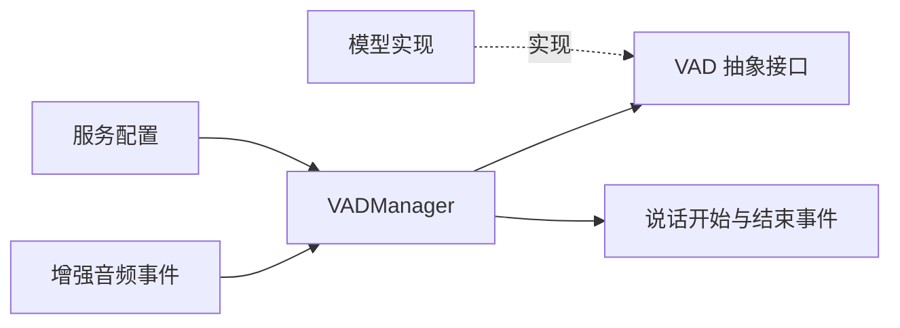

# 需求

- 使用远端语音活动检测时，需要减少请求次数，避免检测等待阻塞音频接收。
- 使用已有检测模型时，需要保持现有对话行为，且无需为批量能力修改每个模型。
- 会话中断和结束时，需要正确释放检测资源，防止旧音频的检测结果影响新输入。

# spec

- 通用模型能力。
    - `VAD` 提供非抽象方法 `detect_frames(frames: list[bytes]) -> list[bool]` 和 `async_detect_frames(frames: list[bytes]) -> list[bool]`；单帧 `is_speech`、`async_is_speech`、`reset`、`clone` 的接口继续提供。
    - 每个列表元素是一帧 PCM16 单声道音频；沿用现有采样率契约，批量接口不隐式转换采样率、不拼接后重新划分帧。空列表返回空结果且不调用模型。
    - 默认同步方法按列表顺序调用 `is_speech`；默认异步方法按列表顺序等待 `async_is_speech`。不使用并发调用或线程池并行处理同一会话的帧，以保留流式模型状态及既有异步优化。
    - 原生批量实现可以覆盖上述方法；返回长度与输入帧数一致，每项为 bool，结果顺序与输入一致。manager 验证完整结果后再更新判定状态，禁止接受缺帧、额外结果或非 bool 值。
- 配置与兼容性。
    - `service_config.vad_batch_frames`，默认 1，允许整数 1–32；bool 和非整数值无效。
    - `service_config.vad_batch_wait_ms`，默认 128，允许有限正数；只在批量模式且已有完整帧、数量不足一批时生效，单帧模式不攒帧、不等待该计时器。
    - `service_config.vad_max_queue_frames`，默认 256，允许不小于批量帧数的整数；bool 和非整数值无效。该容量约束批量模式的待处理音频，不包含最多一批正在推理的音频。
    - 现有 `vad_sample_rate`、`vad_frame_samples`、`vad_min_speech_ms`、`vad_redemption_ms` 保留含义及默认值。通用 manager 按配置切帧，不附加具体模型的固定帧长限制；各模型仍负责校验其实际支持的音频格式。
    - 默认批量帧数为 1 时保留当前事件处理中的逐帧等待、结果平滑及错误帧视为非语音的行为；不默认开启后台缓冲，不改变已有事件完成时机。
- 批量模式调度。
    - 批量帧数大于 1 时，音频接收处理仅执行格式校验、缓冲写入和唤醒，不等待远端推理；每个会话只有一个后台推理任务，同一模型实例的请求严格串行。
    - 音频可跨输入事件拼成完整帧，所有已接收字节按原顺序保留；不足一帧的字节等待后续输入补齐，不补零、不重复发送。
    - 达到配置批量帧数立即发送；不足一批时，从最早待处理完整帧进入缓冲的时刻计算等待上限，到期发送现有完整帧。后续输入不重置该上限；等待期间已经耗尽上限的帧不再增加一次完整等待。
    - 完成推理后逐帧调用原有状态推进逻辑，帧计数依据音频时长，而非 HTTP 请求数或网络耗时；开始说话和结束说话阈值、事件 origin 与 dispatch mode 保持不变。
    - 待处理缓冲以帧字节数换算容量，剩余不完整帧字节也计入；容量不足时明确报错，拒绝整个新增音频块，不覆盖或静默丢弃已有队列，不引入无界后台任务。
    - 批量推理异常或返回契约不符时记录错误，并将本次请求涉及的帧逐帧按非语音推进，保持现有默认错误策略；不自动重放模型请求，避免重复推进有状态模型。缓冲区溢出属于接收错误，不伪造未接收音频的检测结果。
- 生命周期与隔离。
    - 文本输入中断先暂停声学检测，清空待处理音频及平滑状态，并使正在执行请求的结果失效；等待该请求实际结束后重置模型。不得在模型仍推理时调用 reset，也不得将旧结果应用于后续输入。
    - 文本轮次结束后按已有事件契约恢复声学检测；重置前后的音频和模型状态不得混用。
    - shutdown 停止接收新音频、丢弃待处理尾部、唤醒等待任务，等待正在执行的推理及后台任务结束，再重置模型并释放资源；同步线程中的推理不得因外层任务取消而与 reset 并发运行。
    - 处理网络模型的关闭等待沿用模型请求超时；不增加通用模型超时配置。模型 reset 或推理失败均需保证调度锁和后台资源正常退出。
    - 模型 clone 及 manager 状态仍按会话隔离；一个会话的队列、中断或错误不影响其他会话。
- 客户端接入。
    - 支持原生批量的客户端接收通用帧列表，在自身实现中校验模型限制并构造请求；连接复用、状态顺序和资源清理由客户端负责。
    - 使用者通过普通模型配置和通用 `VADManager` 启用批量能力，无需定制 manager、SDK 子类或运行时类替换。
# 设计

```text
xtalk/
├── src/xtalk/
│   ├── models/vad/interfaces.py             # 通用单帧与批量模型契约及顺序回退
│   └── serving/modules/vad_manager.py       # 帧缓冲、批量调度、说话事件和生命周期管理
└── tests/
    ├── test_vad_batching.py                 # 接口回退、批量调度及兼容性测试
    └── test_text_input.py                   # 文本中断和声学检测恢复测试
```



- 模型与调度职责。
    - `VAD` 提供实际被 manager 和客户端调用的批量公共接口；不新增能力标记、模型注册方式或未使用的接口。`SileroVAD` 的本地和 WebSocket 实现直接继承顺序回退，无需改变其协议。
    - `VADManager` 仅依赖 `VAD` 抽象，通过批量方法执行检测；不检查具体模型类型、模型名称、HTTP 路由或协议最大包长。
    - manager 内部使用私有缓冲、唤醒机制、单一后台任务及输入代次标记；同一会话推理与重置串行化，状态平滑和事件输出复用原有方法，不另建公开调度类。
- 配置落地。
    - 批量调用通过 `service_config` 显式启用；例如批量帧数 4、等待上限 128 ms、队列容量 256 帧。既有配置项保持不变，不绑定具体配置文件或部署环境。
    - 初始化 manager 时验证配置；原有单帧模型接口实现无需新增方法即可继续实例化。公共 API 文档字符串遵循 NumPy 风格，并明确输入顺序、返回长度和异步回退契约。
- 验证与验收。
    - 接口测试覆盖只实现同步单帧方法、覆盖异步单帧方法以及原生批量实现，证明空输入、顺序、状态推进和返回契约正确；不并发处理同一有状态模型实例。
    - 默认模式与修改前使用相同音频、结果和错误替身，比较事件序列、开始/结束阈值及 handler 完成时机，证明默认单帧行为兼容。
    - 批量调度测试覆盖跨事件残帧拼接、4 帧请求、原生与回退结果一致、等待上限不被后续输入延长、积压后的尾批及时发送，以及非 512 采样点的通用帧配置。
    - 生命周期测试覆盖推理中继续接收音频、文本中断丢弃旧结果、文本结束恢复、正在执行的同步线程推理完成后才 reset、关闭时不再发请求及会话隔离。
    - 异常测试覆盖无效配置、返回长度或类型错误、批量失败的非语音推进策略、缓冲溢出整块拒绝、资源清理失败，并断言无悬挂任务和模型状态并发访问。
    - 原生批量模型测试验证帧顺序、状态推进及 reset 保留；启动测试验证普通 `Xtalk.from_config` 使用通用 manager 读取批量配置，不依赖类替换。
    - 网络模型验收使用已配置的服务，将真实语音和前后静音以实时速度输入；记录音频时长、总耗时、批量请求次数、请求平均/P95 延迟、接收 handler 耗时及缓冲剩余量，确认事件完整且测试期间无持续积压。网络性能结果按实际测试报告，不承诺固定公网延迟。
- 输入边界。
    - 语音活动检测以音频为输入，不使用语言模型提示词；判定结果进入现有轮次处理流程。
